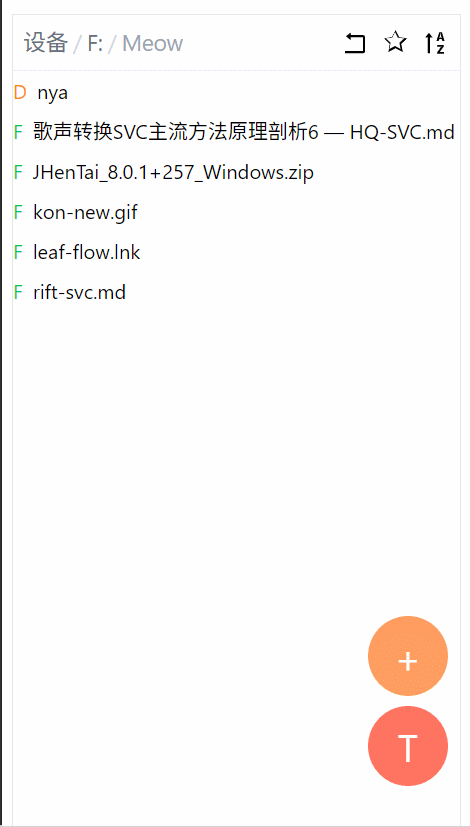

# webpViewer

一个面向本地文件的轻量级 Web 文件浏览器。最初用于快速浏览 WebP 图片，现在已经扩展为可以在浏览器中浏览目标设备文件的跨平台工具：例如在手机上查看电脑中的图片、文本和网页文件。

前端基于 **SolidJS + TypeScript + Vite + Tailwind CSS**，后端使用 **Go + Fiber v3**。后端只负责访问本机文件系统并提供文件接口，前端通过浏览器访问，因此不需要为每种图片格式单独安装查看器。

## 功能

- 浏览 Windows 盘符和 Unix-like 系统的 `/` 根目录，并通过面包屑或地址栏跳转路径。
- 支持按名称、修改时间和随机顺序排列目录内容；目录始终排在文件之前。
- 浏览常见图片、文本、HTML 和 MHTML 文件；JFIF 文件会按 JPEG 返回。
- 解析 Windows `.lnk` 快捷方式和文件系统符号链接，并支持跳转到链接目标。
- 在浏览器中下载当前文件，或将可预览内容复制到剪贴板。
- 上传文件到当前目录，并通过文本编辑框直接创建文本文件。
- 收藏“站点 + 路径”，收藏数据保存在当前浏览器的 `localStorage` 中；可以切换已收藏的站点并删除收藏。
- 使用 URL hash 保存当前目录和文件，刷新页面或复制地址后可以恢复浏览位置。
- 支持桌面键盘操作和移动端滑动、双指缩放；文本和文件列表滚动时会优先保留原生滚动行为。

## 截图

<div style="display: flex;align-items: center;flex-direction: column;justify-content: space-around;">
  
  <p>移动端演示（v0.7.9）</p>
</div>

## 快捷操作

### 文件浏览器

- 右上角工具栏：返回上一级目录、收藏/取消收藏当前路径、展开收藏菜单、选择排序方式。
- 收藏菜单：可按站点查看已收藏路径，也可以删除某个站点或路径的全部收藏。
- 路径栏：默认显示面包屑导航；点击路径栏空白区域后可直接输入路径，按 `Enter` 跳转，按 `Esc` 取消编辑。
- 点击「设备」：回到设备根视图；Windows 显示可用盘符，Unix-like 系统显示 `/`。
- 文件信息栏：显示文件名、大小和 MIME 类型，提供下载、复制、隐藏信息等操作；链接文件还会显示链接目标跳转按钮。
- 文件列表底部的 `+`：上传文件到当前目录。
- 文件列表底部的 `T`：创建文本文件并上传到当前目录。

> 收藏以“站点 IP/Origin + 路径”为单位保存在浏览器 `localStorage` 中，不同设备或浏览器之间不会自动同步。

### 键盘

需要先让主界面获得焦点：

- `W` / `S`：切换上一个/下一个文件（会跳过目录）。
- `A` / `D`：在文件浏览器和文件预览界面之间切换。

### 手势

- 上滑 / 下滑：切换上一个/下一个文件。
- 左滑 / 右滑：切换功能界面。
- 双指缩放：放大或缩小图片等可缩放内容。

手势会自动让位给原生滚动：在可滚动的文本、文件列表或其他内容上滑动时只滚动内容，不触发翻页；双指操作期间不会误触发单指翻页。翻页阈值会根据屏幕短边自适应，快速轻扫也可以触发翻页。

## 使用（Windows / Linux）

### 从源码构建并运行

前置条件：

- [Bun](https://bun.sh/)
- Go 1.25 或更高版本

项目使用 Bun 管理前端依赖，使用 Go 编译 `server` 后端。请在项目根目录执行：

```sh
bun install --frozen-lockfile
bun run build
```

`bun run build` 会完成以下工作：

1. 构建 SolidJS 前端并写入 `dist`。
2. 根据 `package.json` 生成 `dist/version.json`。
3. 编译当前操作系统对应的 `server` 原生服务端。
4. 复制 `server/config.yaml` 到 `dist/config.yaml`。

构建完成后，必须进入 `dist` 目录运行服务端，使其能够读取同目录下的 `version.json` 和 `config.yaml`：

```sh
cd dist
```

Windows：

```powershell
.\server.exe
```

Linux：

```sh
./server
```

服务端默认监听 `0.0.0.0:23333`，并访问 `/index`。默认情况下启动后会尝试自动打开浏览器；无图形界面的 Linux 环境需要安装 `xdg-open`，也可以在配置文件中将 `openBrowser` 设为 `false`。

### 打包发布

Windows PowerShell 可以使用仓库根目录下的 `bundle.ps1` 构建并生成 ZIP 发布包：

```powershell
.\bundle.ps1
```

脚本会读取 `package.json` 的版本号，并在 `dist` 中生成类似 `webpviewer v0.7.9.zip` 的发布包。ZIP 内直接包含可执行文件、前端资源、`version.json` 和 `config.yaml`，解压后运行对应平台的服务端即可。

如需在打包后将 `dist` 内容复制到已有目录，可传入目标目录：

```powershell
.\bundle.ps1 -CopyTargetDirectory 'D:\your\target'
```

### 配置文件

服务端从**当前工作目录**读取 `config.yaml`。发布包或源码构建后的推荐运行目录是 `dist`。

| 配置项 | 默认值（发布包） | 说明 |
| --- | --- | --- |
| `host` | `0.0.0.0` | 监听地址；使用 `0.0.0.0` 可让同一局域网的其他设备访问 |
| `port` | `23333` | HTTP 服务端口 |
| `mountPoint` | `/index` | 前端页面挂载路径 |
| `appRoot` | `.` | 前端静态资源和 `version.json` 所在目录 |
| `bodyLimit` | `1048576000` | 请求体大小上限，当前约为 1000 MiB |
| `openBrowser` | `true` | 启动后是否自动打开浏览器 |

在同一局域网内使用手机访问时，请使用运行服务端电脑的局域网 IP，例如：

```text
http://<电脑局域网IP>:23333/index
```

## 开发命令

```sh
bun run dev      # 启动 Vite 开发服务器
bun run build    # 构建前端并编译 server
bun run serve    # 预览已构建的前端资源
```

当前 Vite 开发服务器监听 `6628` 端口；开发模式下 API 代理配置在 `vite.config.ts` 中，后端服务需要与代理目标端口保持一致。生产构建不依赖 Vite 代理，由 `server` 同时提供静态资源和文件 API。

## 当前计划

- [ ] 为文本预览增加编辑并保存文件的能力。
- [ ] 优化 Blob 的预加载和缓存，减少连续翻页时的等待。
- [ ] 引入 ffmpeg 做转封装/转码支持更多预览视频格式

## License

[MIT](./package.json)
