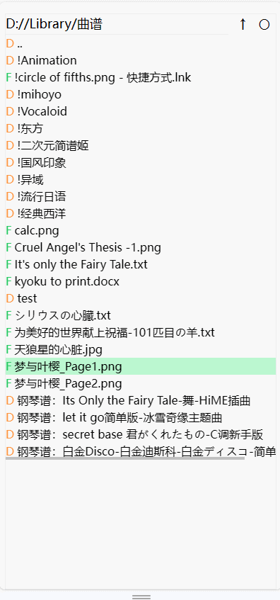

## webpViewer
原意是有不少图片是webp格式，windows无法直接查看，每次一张张用浏览器打开很麻烦，就想整一个能快捷翻页的js脚本。结果写着写着用上了express，支持了其他图片格式，也加了一些快捷键，适配了手机端。

现在的样子更像是一个文件浏览器，代码基于solidjs+tsx，支持用其他设备浏览目标设备的文件图片（用手机看电脑上的图片）。样式比较简陋，主打一个凑合Ψ(￣∀￣)Ψ

## screenshot

  
  
mobile demo v0.3.1

## TODO
- [x] 列出目录内容时支持按时间排序
- [x] 允许收藏当前路由
- [x] 导航栏条允许点击跳转
- [x] 优化滑动翻页
- [x] main.go配置项从当前目录的文件中读取
- [x] 读取package.json并在命令行输出版本号
- [x] 临时文本上传
- [x] 文本内容复制
- [x] textpanel: + padding
- [ ] textpanel: + 编辑功能
- [x] 随机选择
- [x] 页面标题随打开的文件夹变化
- [ ] 优化blob读取: 预加载/缓存(blob)
- [x] 初次点击上传图片非常慢，而且初次上传图片会失败，必须重试
- [ ] 增加对链接文件的支持， datapanel 页面header处增加按钮[跳转]
- [x] 支持html浏览
- [x] 支持mhtml浏览
- [x] 文件上传
- [x] 滑动翻页
- [x] 支持linux，windows盘符选择（上一级到尽头进入 Computer 根，列出盘符 / `/`）

## shortcut
### common
- fileexplorer右上方: ↑返回上一级目录，☆收藏/取消收藏当前目录，▾展开收藏夹（点击跳转，×删除），〇刷新
- fileexplorer路径栏下方: 面包屑导航，点击任意一级直接跳转（「此电脑」回到盘符选择）
- 点击datapanel上方: 显示/隐藏文件信息与下载按钮（即文件名）

> 收藏保存在浏览器 localStorage，按设备/浏览器各自独立

### keyboard
- ws: 切换浏览的文件
- ad: 切换功能界面

### gesture
- 上/下滑动： 切换浏览的文件
- 左/右滑动: 切换功能界面
- 双指缩放: 放大缩小

> 手势会自动让位给原生滚动：在可滚动的文本/列表上滑动只滚动内容不翻页；双指缩放期间不会误触发翻页。滑动距离阈值按屏幕尺寸自适应，快速轻扫也能翻页

## use (windows)
### install from source
1. open terminal
2. git clone
3. cd webpViewer
4. pnpm i
5. pnpm build
6. go build -C server/v3
7. webpViewer.ps1

### release
1. download release
2. unzip
3. webpViewer.ps1
